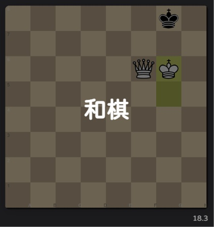
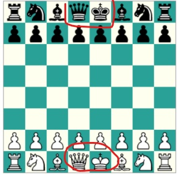
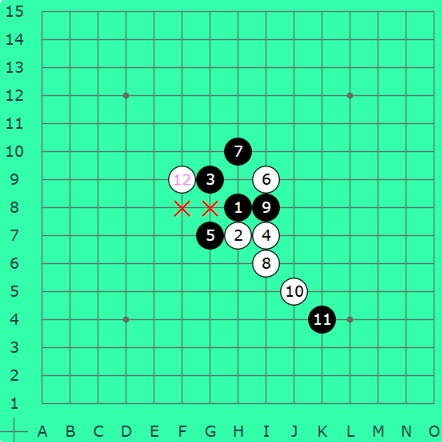
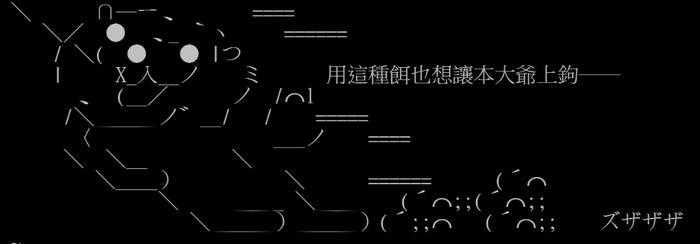

### 前言

　　蛤？我打宿儺[^1]，呃不是，我來介紹西洋棋的有趣小知識？這不是[錯棚](https://shuojen.com/docs/chess)了嘛！

　　對於西洋棋，除了基本規則外幾乎一無所知的我，回想起七月投稿文章中，原先碩人也[考慮過](https://shuojen.com/blog/2026/06/20/fun_fact)投稿西洋棋的冷知識但最後被我間接（？）勸退的事。但就在前陣子，碩人的西洋棋殘局練習系列卻讓我赫然發現有個超適合投稿的西洋棋冷知識，於是，我決定在今年還沒過完之前，完成碩人大大的心願（並沒有這種心願）。

　　順帶一提，[BlogBlog 同樂會 2026 年 7 月的主題](https://blogblog.club/party/#-%E7%AC%AC-7-%E6%9C%9F%E6%9C%89%E8%B6%A3%E7%9A%84%E5%B0%8F%E7%9F%A5%E8%AD%98%E6%88%96%E5%86%B7%E9%96%80%E6%A6%82%E5%BF%B52026-%E5%B9%B4-7-%E6%9C%88)是「[有趣小知識或冷門概念](https://shuaixin.cc/Fun-Fact/)」，如果在今年都快過完的當下還是對有趣的小知識或冷門概念念念不忘（到底要有幾個念），那我誠摯推薦由該月同樂會主持人[劉昕](https://shuaixin.cc/)主持的「[一個讀書會](https://club.1-know.org/)」，可以學到更多有趣的小知識喔！

### 本文

　　廢話不多說，今天開門見山介紹西洋棋的有趣小知識，那就是西洋棋有條規則，叫做「逼和（Stalemate）」。

　　「逼和」是什麼意思呢？簡單來說，如果盤面上無論王怎麼動都會造成王被吃，又沒有其他棋步可走，那這局面就叫做「逼和」。上面圖例就是白棋造成黑棋的王無論走哪步都會被敵軍狙殺，無路可走形成了「逼和」，因此這在西洋棋上被判定為「和棋」，雙方平手。

　　等等！為什麼是平手啊！太違反常理了吧！！！🫪

　　想像一下，兩軍經過激烈交戰後，我方終於將敵方主將逼到懸崖邊，對方如果後退一步就會掉下懸崖，前進一步就會落入我的槍口中。結果，有個謎之音從天而降：「我認定這場仗雙方平手，你可以撤軍了。」

> 這是一個不公平的比賽啊，欸笑死人欸，我把對方逼到死角欸，欸你們裁判是怎麼判的啊，欸不是，我把對方逼到死角然後判平手喔，被我搞到無路可走的算平手喔，有沒有邏輯啊，不是啊……（下略）[^2]
> 

　　看吧，我方將軍（？）都暴跳如雷了。雖然早在一開始就知道有這規則存在，但在遊玩〈[單后殺王](https://shuojen.com/blog/2026/11/16/queen_mate)〉時，因為象棋養成的習慣，第一次還是手比腦快導致不小心走出了逼和的局面。

　　好奇心驅使，我立刻跑去查了[維基百科](https://zh.wikipedia.org/zh-tw/%E6%AC%A0%E8%A1%8C)的「欠行」條目：

> 其中，[西洋棋](https://zh.wikipedia.org/wiki/%E5%9B%BD%E9%99%85%E8%B1%A1%E6%A3%8B)與[泰國象棋](https://zh.wikipedia.org/wiki/%E6%B3%B0%E5%9C%8B%E8%B1%A1%E6%A3%8B)將欠行判為[和棋](https://zh.wikipedia.org/wiki/%E5%92%8C%E6%A3%8B)，稱逼和；而除此之外大部分禁止棄權一手的象棋類遊戲，如[中國象棋](https://zh.wikipedia.org/wiki/%E4%B8%AD%E5%9B%BD%E8%B1%A1%E6%A3%8B)、[日本將棋](https://zh.wikipedia.org/wiki/%E6%97%A5%E6%9C%AC%E5%B0%86%E6%A3%8B)、[蒙古象棋](https://zh.wikipedia.org/wiki/%E8%92%99%E5%8F%A4%E8%B1%A1%E6%A3%8B)，以及歷史上的[波斯象棋](https://zh.wikipedia.org/wiki/%E6%B3%A2%E6%96%AF%E8%B1%A1%E6%A3%8B)等，均規定欠行方作負，稱困斃或必死。
> 

> [緬甸象棋](https://zh.wikipedia.org/wiki/%E7%B7%AC%E7%94%B8%E8%B1%A1%E6%A3%8B)則不允許一方造成對方欠行（為禁手棋，跟中國象棋的將帥照面、日本將棋的二步跟打步詰一樣），而[古印度象棋](https://zh.wikipedia.org/wiki/%E5%8F%A4%E5%8D%B0%E5%BA%A6%E8%B1%A1%E6%A3%8B)也規定只要造成另一方欠行就會判負。
> 

　　等等，和棋就算了，古印度象棋（Caturaṅga，也是所有象棋類遊戲的源頭）居然是造成對方欠行反而會輸掉！發明古印度象棋的祖先們真沒有反社會人格嗎（誤）。

　　一不做二不休，我繼續跑去查了下西洋棋的歷史，才發現西洋棋「逼和算平手」並不是一開始就是這樣。當古印度象棋傳入波斯變成了[波斯象棋](https://zh.wikipedia.org/wiki/%E6%B3%A2%E6%96%AF%E8%B1%A1%E6%A3%8B)（7~10世紀）時，逼和就和現在中國象棋一樣，被判定為進攻方獲勝，這套規則後來就直接傳入了西班牙。然而 15 至 16 世紀開始，西班牙棋手認為逼和雖然算贏，但「贏得不夠體面」，因此雖然棋局贏了，但只能拿走一半的賭注，而同一時間英國似乎反而還繼續沿用著「造成對方無路可走判輸」的規則，最後到 18 至 19 世紀後，國際棋會才統一了「逼和算平手」的規則。

　　至此，總算較能同理西洋棋的「逼和」了。如果是中國象棋，孫子兵法都開示「兵者詭道也」，韓非子也說了「戰陣之間不厭詐偽」，因此能把敵軍困到動不了，當然是高明的戰術體現，哪有什麼平手的道理。然而，當時歐洲流行的可不是孫子兵法而是「戰爭禮儀」，在這之下「贏得光不光彩」變成了一件非常重要的事，讓對方無路可逃實在勝之不武，堂堂正正地 checkmate 才是光榮的勝利。

　　可惜先不論西洋棋的殘局美學，實務上當劣勢方眼看要輸了，多半就會開始考慮反過來利用此規則求和。仔細想想，如果不能接受「困斃」是因為勝之不武，「棄子求逼和」這樣的俗辣行為[^2.5]理當該比困斃還該被譴責吧？🤔

### 後記１

　　西洋棋除了逼和這件事很有趣之外，開局的不對稱性也很有趣：

　　持白的時候國王在右邊，但如果持黑棋國王卻是在左邊（到底是[哪邊](https://yangbear.bearblog.dev/migi-hitari/)）！其他棋類遊戲或許都會認為對稱擺放而不是鏡像擺放比較公平，但這也恰恰造就了西洋棋開局戰術的變化來源。沒想到下個棋還跟格鬥遊戲有 1p 2p 問題[^3]要解決，真是非常特別。

### 後記２

　　關於其他棋類「無處可下」或「禁手」的情況，拿我較熟的幾個棋類順帶說明：

### 圍棋

　　圍棋如果沒有地方可下（或不想落子），可以採「虛手」這動作，也就是在棋盤旁擺一顆子，表示跳過自己的回合。若對方還想繼續下，則可以繼續在棋盤上落子，而先前虛手的一方也可以繼續跟著下。直到雙方輪流虛手一次，則代表雙方都同意這盤棋已結束，進入勝負計算階段。

　Ｑ：對方不願意虛手結束比賽，一直狂落無意義的子怎辦？

　Ａ：圍棋是君子之爭，如果對方不是故意的，那就等到需要應對的時候再跟著下就好。如果對方是故意的，請舉手~~敲對面的頭~~請裁判協助判定。

### 五子棋

　　五子棋由於黑棋先手必勝，因此以前正式比賽都會對黑棋棋步做相當程度的禁手限制[^4]。一般有禁手的規則黑棋的雙活三、雙活四、長連（六顆以上連在一起）都被視為禁手，如果黑棋下出禁手的型態則直接判負，也因為這原因，白棋可以利用這規則獲得勝利：

　　圖中紅色叉叉處由於下了會形成雙活三，視為黑棋的禁手，所以白棋可利用這點使得黑棋無法在 G8 防守獲得了勝利，真是有夠 G8（啥）。（圖片出自[台灣五子棋協會](https://www.587.renju.org.tw/teach/teach009.htm)）

　　由於「有禁手規則」比想像中複雜許多（不利推廣），近年部分玩家更喜好無禁手「一手交換規則」，也就是說當黑棋下了第一手後，白棋可以選擇要不要交換成持黑，此後則無任何禁手，隨雙方繼續下直到棋局結束為止。此規則第一個好處是黑棋第一手需選擇一個「不那麼有優勢的位置落子」，不然對手只要一交換，自己就從巨大優勢變成巨大劣勢了。而第二個好處則是相較以前常用的競賽規則，這規則真的簡單許多，想知道以前的規則有多複雜的朋友可以來[這邊看看](https://www.renju.org.tw/rule/renju-rule.htm)~~順便把自己搞瘋~~。

### 黑白棋

　　黑白棋只要有其中一方沒得下，就輪到對方繼續落子，非常直觀。然而如果有地方落子的話則必須落子，因此這也變成了黑白棋前中期策略最重要的一環：「減少對手的選擇。」只要對手選擇越少，對方就更有機會下到「自己不那麼想下」的位置，進而獲得優勢。

　　黑白棋的詰棋（殘局）也非常有趣喔！有興趣的朋友可以來[這裡看看](https://www.othello.org/egev/)，這網站每天都會更新不同的題目，不要小看只有幾個地方可下，如果是新手可能會卡非常久，可以先來[初級篇](https://www.othello.org/egev-easy/)試試！

### 總結

　　後記一不小心打太多把這篇從「西洋棋的有趣小知識」變成了「棋類的有趣小知識」了。最近祖克伯的演算法突然很喜歡推給我圍棋和象棋的題目，沒想到碩人居然也對上了這宇宙大電波開始推廣西洋棋的殘局……[^5]

　　有趣的小知識，我們下次見。（大概沒有）

[^1]: [我打宿儺真的假的](https://memes.tw/maker/template/63066)（From 迷因梗圖倉庫）

[^2]: [統神《拳上》輸蹦闆不服判決台上爆氣開嗆：我全程沒退](https://www.youtube.com/watch?v=iK4IUUJsC7s)（From YT）

[^2.5]: 這讓人想到跆拳道比賽只要對手倒地就禁止追擊，說是「選手安全並維護比賽的公平性與武道精神」，結果這項規則被許多選手巧妙利用整天假裝摔在地上，反而變得超級滑稽。

[^3]: 格鬥遊戲由於 1p 側和 2p 側角色方向不同，因此同一套連段搖桿轉的方向也會完全相反，因此同一連段也必須兩側都練習。而且，就連魔法氣泡也同樣有這問題，但有空再細說（？）

[^4]: [國際連珠聯盟](https://zh.wikipedia.org/wiki/%E5%9B%BD%E9%99%85%E8%BF%9E%E7%8F%A0%E8%81%94%E7%9B%9F)在第一屆到第十屆[世界連珠錦標賽](https://zh.wikipedia.org/wiki/%E4%B8%96%E7%95%8C%E8%BF%9E%E7%8F%A0%E9%94%A6%E6%A0%87%E8%B5%9B)先採用三手交換，五手兩打的[RIF規則](https://zh.wikipedia.org/wiki/RIF%E8%A7%84%E5%88%99)，後為適應不同層次的連珠愛好者參與比賽，現代連珠比賽有多套開局規則並行，相繼衍生出[山口規則](https://zh.wikipedia.org/wiki/%E5%B1%B1%E5%8F%A3%E8%A7%84%E5%88%99)、[索索夫規則](https://zh.wikipedia.org/wiki/%E7%B4%A2%E7%B4%A2%E5%A4%AB%E8%A7%84%E5%88%99)、[坂田規則](https://zh.wikipedia.org/wiki/%E5%9D%82%E7%94%B0%E8%A7%84%E5%88%99)、[塔拉-山口規則](https://zh.wikipedia.org/wiki/%E5%A1%94%E6%8B%89-%E5%B1%B1%E5%8F%A3%E8%A7%84%E5%88%99)、[塔拉尼科夫規則](https://zh.wikipedia.org/wiki/%E5%A1%94%E6%8B%89%E5%B0%BC%E7%A7%91%E5%A4%AB%E8%A7%84%E5%88%99)等。（From [維基百科](https://zh.wikipedia.org/zh-tw/%E8%BF%9E%E7%8F%A0)）

[^5]: 原本想用「用這種餌也想讓本大爺上鉤.txt」但有辦法感應的朋友大概非常稀少因此作罷🥲