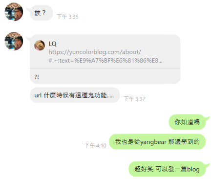

　　初次學到這 URL 功能，是因為格友 [yangbear](https://yangbear.bearblog.dev/) 在某篇文章中使用此語法引用了其他格友的某段話。所以當 yangbear 在某篇文章 murmur 自己不是資訊專長所以講的東西可能太膚淺或許大家都早已知道時（真有這篇文嗎還是又曼德拉效應），原本想用「#:~:text=」[^1]當作例子去回應，結果最後不了了之。

　　然而就在剛剛，為了和[李唯](https://blog.wei-lee.me/pages/about-me)解釋[駿恆老師](https://www.dragon-art.tw/)到底是誰所以貼了[這個](https://yuncolorblog.com/about/#:~:text=%E9%A7%BF%E6%81%86%E8%80%81%E5%B8%AB%E7%9A%84%E8%AA%B2)給他看[^1.5]，結果：　　

　　沒錯，「#:~:text=」這招可是連 [Apache Airflow](https://github.com/apache/airflow/) PMC 成員、臺灣華語程式碼負責人與翻譯負責人[^2]都不知道！在沒有 AI 的年代，PCMAN[^3] 的作者也同樣不是資工本科，所以只要肯將知識寫出來，就連愛因斯坦也有可能從格友們的 Blog 中學到新知喔[^4]！😊

### 後記

　　單純想給 yangbear 大大一些信心與鼓勵，什麼，你說人家沒說需要，好吧，那就算是給自己的鼓勵，畢竟之前都貴為西洋棋新手還寫了[有趣小知識](/chat/chess-fun-fact/)，那麼下次我也要寫太鼓達人有趣小知識[^5]！

### 後記２（11/26 10:10 更）

　　[Spike](https://taxodium.ink/) 大大在[留言板](/guestbook/)提供了更棒的方法：只要在頁面選好想選的文字後後右鍵， 「Copy link to highlight」（如果是 Brave 的瀏覽器，繁體中文顯示的是「複製醒目文字顯示的連結」），這樣就可以了！

　　果然只要拋點磚就會有更多知識聚集在一起，這不是超棒的嗎🥹🫴

[^1]: 每次要用的時候都會忘記怎麼打，這篇文章的另外一個目的就是讓我想用的時候可以直接複製標題。

[^1.5]: 現在想想貼這個根本也沒解釋到任何事🫠

[^2]: [李唯](https://blog.wei-lee.me/pages/about-me)：「？」

[^3]: [https://pcman.ptt.cc/about.html](https://pcman.ptt.cc/about.html)

[^4]: 想了一下愛因斯坦能從本 Blog 學到什麼新知，嗯，我想應該能至少學到[「燈」的念法](https://lq7.tw/mood/tomori/)吧。

[^5]: 松旁邊敲10下可以叫出鬼模式算嗎？等等，現在還要敲嗎？😩