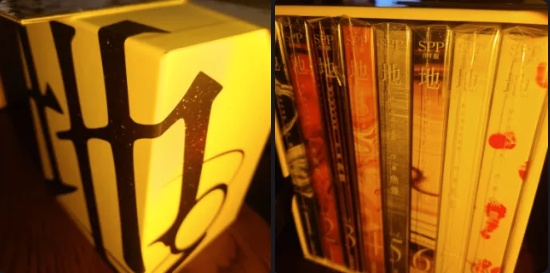
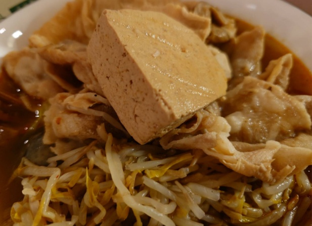

　　上星期四沒有打羽球！

　　當時等到當天都沒有開團消息，就有預感不妙，果然，團長因公出差，上週羽球團暫停一次。

　　於是，當時的行程就是邊吃晚餐邊看 Netflix 的益智遊戲實境秀《魔鬼的計謀》第三季了。目前雖然還沒更新完結，但精彩程度已超越前兩季，片名「魔鬼的計謀」恰恰反映出這場秀的醍醐味，舉例而言對我來說研究最深入的桌遊[^1]《波多黎各》，如果大家公平競爭，沒有認真研究的朋友鐵定無法戰勝我，但如果他們聯合起來對付我的話，我有辦法贏嗎？

　　每次看著這部實境秀，都會讓我想到《噬謊者》這部漫畫。這世界上能像平常桌遊那樣「公平公正公開」的對決，其實是少數，而《魔鬼的計謀》系列無論是場內場外的遊戲設計，恰好表現出現實社會的「表」與「裏」，完全符合我對益智遊戲實境秀的喜好，這節目或許也能推薦給同為益智遊戲愛好者（[碩人](https://shuojen.com/)？）之類的朋友，非常精采。

　　但可惜《噬謊者》漫畫最後也有點爛尾就是，如果能保持從一而終的節奏，或許我會更喜歡一點。但我也老早就理解，也不是所有人在閱讀小說或漫畫時，都和同樣在意故事的節奏。

　　之前看到某位作家的訪談，她表示喜歡她故事的人剛好拆成兩類，第一種是喜歡她流暢的劇情與精煉的文字，第二種則是偏向單純喜歡主角間的情感互動。後者那樣的讀者，更關心主角們的關鍵行動，比如說「這兩人什麼時候才要在一起」、「這人怎麼可以這樣」，至於到底有沒有符合劇情的發展邏輯，反倒是其次。

　　雖然我看故事時比較像是第一種人，但一個成功的故事，可以讓這兩種人同時看得非常開心，我想《地。-關於地球的運動-》就是這樣的漫畫，故事中無論是角色情感還是故事節奏甚至背後的核心思想，三者很好地拉扯了在一起，實在非常厲害。

　　總覺得上面這段話在[另一篇文章](https://lq7.tw/reading/five-comics/#%E5%9C%B0-%E9%97%9C%E6%96%BC%E5%9C%B0%E7%90%83%E7%9A%84%E9%81%8B%E5%8B%95-)已經寫過，但如果是這部漫畫，多推薦幾次也無妨，近十年已不蒐藏任何實體漫畫的我，居然買了整套一本要價近 500 元的豪華版，連自己也嚇到。

　　收到這套書時，也讓我猶豫是不是該把[《火之鳥》復刻版](https://www.tohan.com.tw/product.php?act=view&id=4425)套書也順便買一下，但實體書真的非常麻煩，畢竟家裡的空間實在有限，加上也不像[劉昕](https://shuaixin.cc/)如此愛藏書（？），最近還想將以前的書都一起清一清。果然只要接觸過[近藤麻理惠](https://zh.wikipedia.org/zh-tw/%E8%BF%91%E8%97%A4%E9%BA%BB%E7%90%86%E6%83%A0)，她的想法這輩子就會開始陰魂不散地跟著你，非常可怕。

　　其實今天的場邊閒聊原本也是有「精心策劃」過，但打到現在似乎還沒提到任何大綱內的事，總覺得在羽球場邊跟著腦袋的 flow 打字，還是較有本系列的醍醐味。回頭看自己的羽球系列時[^2]，有幾篇自己還真的非常喜歡，可以想像當時腦袋的運轉過程，然而有些「精心策劃」過的集數，那些精心策劃的痕跡也會隨著文章留下來，回頭看時會在內心稍微吐槽「這邊也轉得太硬了吧」之類的。

　　當然，轉得太硬或將這種文字痕跡留下來其實也沒不好，畢竟這也是趁打羽球的空閒時間雜談一下本來就想寫的事情。比如說今天的大綱本來想寫[等公車](https://trashposts.com/blog/catching-the-bus/)我鐵定是用跑的，還有想談談[用不用 git](https://wiwi.blog/blog/you-should-use-git) 這件事情。

　　以前學習[電繪](https://yuncolorblog.com/about/#:~:text=%E9%A7%BF%E6%81%86%E8%80%81%E5%B8%AB%E7%9A%84%E8%AA%B2)時老師影響我最深遠的概念，是「圖層合併」這件事。有些繪師怕合併圖層後無法隨心所欲的更改，因此盡可能地將所有圖層留下來。然而老師卻告訴我們，保持圖層的精簡這件事情非常重要，當你認為這部分完成了，就大膽合併，不要想太多。第一，留了一堆圖層到頭來只是讓自己分不清這圖層到底在幹什麼，徒增整理的麻煩，第二，就算合併了之後要改，真正厲害的繪師就算整張圖沒有任何圖層，也有辦法去做修改。所以如果真需要回頭修改已合併掉的圖層，這也剛好是個練習的機會，這世界上沒有任何一張圖因為圖層合併就無法修改的道理。

　　於是，往後的課堂老師在合併圖層時總會開玩笑：「這些都處理好了，把這些剪裁遮色片選起來，合併！」，「會怕嗎？」（同學們：會！）「就說了不要怕，會怕就代表還沒出師喔！」

　　雖然電繪的技術到目前為止已幾乎還給老師，但這「圖層合併」的哲學，直到現在都還是非常受用。以前的我也是 _V1.0 _V1.1 _V2.0 _VFinal_1.0 一族，但從那之後，我的所有事情包括那四本小說，就算每一本從初稿到完稿都改了十幾次以上，我依舊永遠只留初稿和最後完稿的版本。理由也和學電繪時老師的教誨相同：第一，留了一堆版本到頭來只是增加自己的整理負擔和佔硬碟空間，實際上根本不會去用[^3]，第二，就算真有回頭要改的東西，從最後的版本去改就好，真正厲害的作家，哪有因為沒留先前版本就改不了作品的道理？

　　這樣的生活哲學，和近藤麻理惠提倡的極簡主義也類似。有人怕將家裡東西丟掉的最大原因，就是「以後還有可能用到」，但為了這虛無縹緲的「可能」，卻付出了許多生理（空間）或心理上的隱藏成本。

　　說穿了，人生其實不需要這麼多的物品，也沒有這麼多的事情需要版本控制。

　　才說今天不想照著大綱走，結果搞到最後還是回應了話題，真是抱歉。最後為了慶祝羽球系列的集數正式從兩個字變成了三個字，我們還是得謹慎思考一下今天該吃點什麼慶祝。老實說，每次都吃麻辣臭豆腐實在非我所願，因為這已經是看起來相對有蛋白質有菜有澱粉的均衡飲食了[^4]。如果扣掉這個和麥當勞，只剩下一間有點髒的麵食館，還有肉粽碗粿攤，還有炒羊肉的店家。炒羊肉有時候會吃，但其實還是比麻辣臭豆腐來得不健康一點，這附近的火鍋店又剛好十點通通關光光，看來今天一定要想辦法開發新的店家，說什麼也不要再吃麻辣臭豆腐或麥當勞了。

　　下周四受朋友邀約有事得辦，因此星期四打羽球，我們下下周再見。

### 後記

　　我真的傻眼。

[^1]: 其實我研究最深的桌遊鐵定是圍棋，但撇開狹義上古時期流傳下來的桌遊們，以近年設計出來的桌遊，理解最深的確實是[《波多黎各》](https://zh.wikipedia.org/zh-tw/%E6%B3%A2%E5%A4%9A%E9%BB%8E%E5%90%84_(%E6%A1%8C%E6%B8%B8))的三人四人局，雖然已經超過十年沒有玩了。

[^2]: 其實我很常回去看自己打過的文章，光全部的羽球系列就看了三四次以上。這或許也能分成「很愛看自己寫的文章」和「從來不看自己寫過的文章」的兩類 Blog 作者？

[^3]: 說來工作用了二十幾年的 git，還真想不起上次被「因為有保留前幾版」所救到底是什麼時候，唯一能清楚想起的事件反而是「因為用了 git 導致檔案消失」的精采事件，但這個有空再細說（細說系列怎麼越來越多）。

[^4]: 火鍋類雖然看似有高蛋白質與蔬菜的膳食纖維，但將高鈉高油脂算進去其實也沒多健康🥲