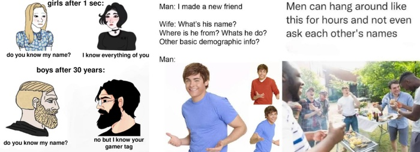
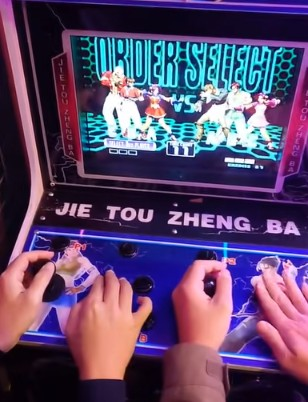

### 前言

　　前陣子接受這邀請函[^1]，參加了一場攝影師交流茶會。

　　活動基本就是吃個下午茶，現場也有請模特並架設簡易的棚，由前輩老師們教學，分享些攝影理念與技術操作並帶大家拍拍照。我座位正對面剛好是不認識的攝影師，雖然是第一次見面，但因為共同興趣（攝影），很快就聊了起來。我們討論到有哪些景點比較好拍，並互相觀摩雙方先前的作品。活動最後我們交換了 IG，離開會場後才想到……

　　根本沒問對方名字。

　　於是，趁著「[BlogBlog 同樂會 12 月](https://blogblog.club/party/)」的主題「[人際關係與頻率](https://blog.nudoragon.com/post/blogblog-party-relationship)」，我打算聊聊「男生之間不論多熟，還是有可能不知道對方名字」這件事。這也是我的 12 月份同樂會投稿文章，歡迎各位一起參加！

（眾多的類似迷因）

### 本文

　　台灣以前無論是音 Game 還是格鬥遊戲，如果講求舒適的遊玩與對戰體驗，最快的方式就是跑去大型電玩間。由於會去玩的人來來去去就是那幾個，久而久之就算沒講過話，也會大概知道對方是誰。

　　然而就算在電玩間一整年不斷遇到那些人，會打招呼，偶爾還會一起吃個飯，卻總是不曾開口問對方名字，最多就只記得對方的遊戲卡名[^3]，彷彿所有事當中名字就是最不重要的那個。仔細想想，男生間的對話的確很少需要使用到名字，如果真需要叫對方，沒有什麼是「欸」不能搞定，如果有，就「欸」兩次。

　　但，如果要和其他朋友講原本朋友Ａ的事，那就沒辦法用「欸」了。怎麼辦呢？這時候只好使用第二招，就是「幫別人隨便取個綽號」。

　　這人每次來玩的時候都拿一塊雞排，嗯，那他就叫「雞排」，那人在網路上的 ID 是 S 加上一串數字，那他就叫做「S數字」，真人真事毫無改編。隨後，這些「就地取材」的綽號就這樣跟著這些人十幾二十年，這或許也是男生為何在不同圈子會有不同綽號的最大原因。

　　講到「幫人取綽號」這件事，就不得不提當時大型電玩間最火紅的格鬥遊戲 KOF2002 和 02um 了。就算屬於不同小圈圈的那幾群人一起在機台旁邊玩了好幾年，對方的套路和擅長角色都瞭若指掌，但除了遊戲以外的內容包括名字，依舊一無所知。

　　因此，那人擅長的遊戲角色，自然而然就變成他的「綽號」了。朋友當時使用的遊戲角色「雅典娜」在遊戲間~~非常吉掰~~小有名氣，被其他人叫就會變成「就是那個雅典娜啦」，一位有在健身的巨巨總是將冷門角色「凡妮莎」用得爐火純青，他的綽號就成了「凡妮莎」。當然，KOF 這遊戲需要一次選擇三隻角色，有些不常換角色的玩家，綽號就成了「草八Ｋ」或「金庫八」[^5]之類。說實在，就連我本人也沒跟「草八Ｋ」打過幾場，但只要一講「草八Ｋ」幾乎所有連非本地的玩家都知道就是在指他，非常誇張。

　　額外講講「金庫八」的故事。這位玩家雖不在我和朋友的小圈圈內，由於非常愛用這三隻角色也鮮少換角，久而久之我和朋友之間就這樣稱呼他。當然對戰久了偶爾也會打招呼，但除了打招呼，就真的沒有其他交流了。進店點個頭，坐到對面投錢，就開始廝殺好幾小時。累了準備離開時，再點點頭，揮揮衣袖不帶走一片雲彩。

　　結果，某次朋友不知道從哪聽到謠言說他在補習班教英文，「金庫八」的綽號就此變成了「英文老師」，但直到最後電玩間都倒了也和這玩家就此失去聯繫後，還是無法確定這唯一的身家資訊到底正不正確。

　　為確保以上這些男生小圈圈的故事不全然是性別刻板印象，我特地找了身邊的女性友人們討論，結果的確沒聽過女生認識了超好的朋友，還不知道對方名字的情況，更枉論每周一起打電動好幾小時持續好幾年的人。

　　當然，事情總不會像迷因圖所說得如此誇張，許多較為熟識的好友，總會在某些地點[^6]意外得知對方的本名。幾個更熟的朋友在一起時比起暱稱，反而喜歡用本名稱呼對方，或許本名在這樣的生態圈也算是一種「[黑話](https://lq7.tw/mood/slang/)」也說不定。

　　不知為何，我很喜歡男生們不重視姓名暱稱，而聚焦在「行為」的相處方式。或許我只是覺得，這樣的相處模式，帶有一種率直而純真的浪漫吧。

### 後記

　　就在這篇文還沒寫完的 moment，因為朋友從日本回來聚餐，店裡面居然就擺了一台 XX 合一[^7]，其中有 KOF 2002。雖然按鍵配置是非常反人類[^6.5]的

> 　Ｃ　Ｄ
> 
> Ａ　Ｂ
> 

但大家還是夢迴當年，玩得不亦樂乎，還邊玩邊討論這種按鍵配置到底該怎麼玩，因為畫面實在太好笑就錄了下來，讓各位一同感受男生聚會的魅力。



[^1]: 這是本文的彩蛋，如果有人能 Get 到的話，嗯，「我大概知道你（妳）的年齡」[^8]？

[^3]: 音樂遊戲玩家的遊戲 ID，遊玩時會顯示在機台螢幕上，所以最多就是知道這個而已。

[^5]: 「草八Ｋ」（草薙、八神、Ｋ）、「金庫八」（金卡法、Kula、八神），皆是單一個字的角色簡稱。

[^6]: 比如說一起到朋友的婚禮現場才看到大家登記的姓名之類的（然後沒過多久又忘了）。

[^6.5]: 關於 KOF 的按鍵配置……有空再細說（？）

[^7]: 冷知識：KOF2002 之所以當時席捲全台，也是因為大型機台的機板被破解，盜版機板流竄全台所致。

[^8]: 和幾年前流行的[神燈精靈](https://akinator.com)類似，這[小遊戲](https://kepigame.com/games/nenrei.html)可以靠一些問題推算出你的年齡，找了許多朋友試過誤差幾乎在一歲以內，非常有趣，如果要玩請選「繁體中文」，不然就會把你當成日本人問一堆只有日本人才答得出來的問題（某格友慘痛經歷）。