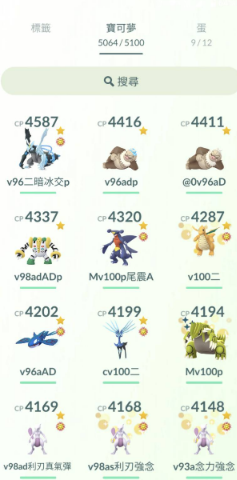

　　（我爸的寶可夢註記，回鍋後得研究一番才勉強看得懂）

　　我爸在他人生的最後，玩了近十年的 Pokemon GO。

　　Pokemon GO 剛推出時，我也是坐朋友後座騎機車到處抓寶的其中一群人，靠著寶可夢地圖雷達繞著運河河岸找拉普拉斯，也參與過半夜兩三點觀夕平台的盛況。當時我爸只說「這到底有什麼好玩」，沒想到我退坑沒多久後才發現他默默下載了遊戲，一個帳號還玩不夠，玩沒多久就將三隻帳號（紅黃藍隊各一）養到 40 級（當時的最高等級）。

　　從那之後雖然我已經沒在玩，回台北總會聽他講些 Pokemon GO 的更新與變化，但多半都在抱怨這遊戲總是想盡辦法讓人課金，越來越讓人玩不下去（但還是一直玩），然而就算玩了十年，三個帳號從沒有課過任何一次金[^1]，我想這就是「自由軟體鬥士」[^1.5]的遊戲之道，非常佩服。

　　Pokemon GO 貴為台灣防失智遊戲 Top1，我岳母剛好也有在玩，雖然沒有我爸那麼重度（只有一個帳號），但也算是每天的生活重心。在我結婚的那天，他們有互相加好友，從那之後，每天都會交換遊戲內禮物。

　　我爸住院隔天，就從太太口中聽說岳母關心我爸是不是有發生什麼事，因為這是這幾年來我爸頭一次沒有送禮物給她。

　　我爸住院後，告訴我媽要將他的手機關機，但我媽大概也搞不清楚他實際上有在用的是哪幾支手機。直到最後所有手機還是自然沒電了。我想到我爸的寶可夢帳號應該是他最珍視的數位遺產，於是我從他的電腦房找出手機，但老實說完全不知道他的解鎖密碼是什麼，像我爸這種聰明人，絕對不會用「生日」之類這種超容易被破解的密碼。結果我妹突然和我說：

　　「格～要不試下你的生日？」

　　當螢幕成功解鎖時，我苦笑了一下。真沒想到我爸這麼喜歡松本潤[^2]，呃不是，就算生日不用自己的，也不用這麼輕易就被我妹破解了Ｒ！搞屁阿！

　　最後，我們決定分贓（？）我爸的三個寶可夢帳號，我使用一號機，我太太使用二號機，我妹使用三號機。最近一次和我妹聯繫她說那邊荒郊野外，道館擺了超久都沒人打，不知道搞啥，我在想是不是我的主帳也給他，這樣就可以輪流洗道館了。

　　最近我岳母都會傳訊息給我太太，說要記得加入她的小隊解任務。某種意義上，我岳母又能繼續收到我爸（的帳號）傳的禮物。

　　或許這樣很好。

[^1]: 說到手遊，我也是曾在《龍族拼圖》花上好幾萬的人，但從某年開始悟道後，之後玩的所有手遊再也沒有課過金，悟道終究是比我爸來得晚。

[^1.5]: 〈[羽球十六](/mood/thursday-badminton-16/)〉的最後一個段落。

[^2]: 〈[生日快樂](/thinking/birthday2026/)〉By LQ7