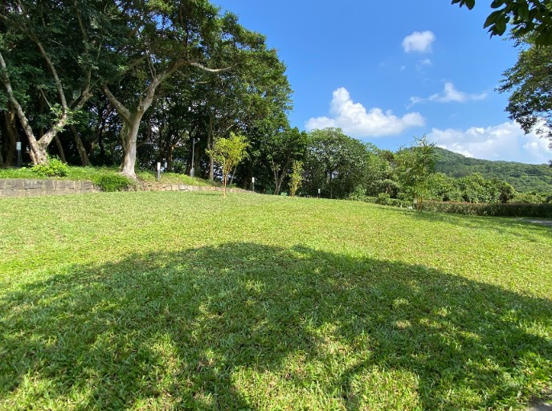

　　我爸的骨灰在昨天埋進了法鼓山生命園區的草皮裡面，而這安葬方式叫做「植存」。

　　原先以為植存只是「樹葬」文學一點的說法而已，但為了寫這篇文章查了一下才發現兩者還是有些微差異，簡單說樹葬的地點還是在公墓內，部分場所也能立碑紀念，而植存則是一塊自然地形，將骨灰倒進挖好的洞即可，不立碑也不留記號。

　　法鼓山將金山生命園區這塊地捐給新北市政府，且為了鼓勵環保葬，任何民眾都可以向新北市政府申請這項服務，且不收任何費用。而法鼓山創辦人聖嚴法師[^1]是這件事的推動者，他對自己的後事是這樣[交代](https://www.leniency.com.tw/news6-65)的：

> 我死後，不需鋪張的追思與傳供，不需布置得富麗堂皇的靈堂。我已預立遺囑，身後既不設牌位、不立碑、不築墳，也不建塔。至於後人對我有任何評論，不重要，也與我無關。我沒有個人財產，即使著作權也屬於僧團。我的身體，用薄薄的棺木封釘，火化以後，也不必有一個骨灰罈來占地方，骨灰就灑在法鼓山的環保生命園區。所有我有形的一切，就在這世上永遠消失。
> 

　　我爸年輕時研究過佛教，然而小時候他就和我說「現在多數的佛教都是假的」，只有聖嚴法師是「真的」。他最常拿來提的例子，是某次過年和我媽一起上法鼓山參加活動某段典禮儀式結束時，司儀突然要大家向聖嚴法師一拜，結果聖嚴法師見狀後作勢要大家趕快起來。

　　「連辦活動的人都沒學到聖嚴法師的皮毛，我看等他過世後，台灣佛教要完蛋。」我爸如此說。

　　小時候這些話只是聽過就算，長大後無意間接觸到許多聖嚴法師的講道影片和其他新聞，才多少能體會我爸的意思，當然，他身邊或許就有個完美的例子，因為我媽自從外婆過世後就不只開始信佛教，還皈依聖嚴法師，這應該算他們兩人少數的交集了，不，應該說我們三人少數的交集，然而我媽所有「學佛」的舉動幾乎都被我爸吐槽過一遍，最後他嘆了口氣，表示「有些人這輩子可能無法理解佛教，那就口唸阿彌陀佛就好，剩下的不要強求，下輩子再說。」

　　當然，這句話我多少還是幫我爸美化過了，實際上他講得還要更尖酸刻薄一點，比如說這次植存我媽拿了一包已分裝好的艾草吩咐我，千萬要讓每個來參加植存的親戚每人拿一個，離開的時候丟掉。光這件事我就能想像我爸從草皮彈起來吐槽「連聖嚴法師的皮毛都沒學到」的畫面。的確，只要稍微思考，如果問聖嚴法師「參加植存需要帶艾草驅邪嗎」，聖嚴法師鐵定笑笑地回「不用也沒關係」，這就是一個主張「不需要任何儀式，只將骨灰埋進草皮後站在旁邊簡單追思」的人會有的回答。

　　但終究，我爸骨灰能撒在法鼓山生命園區，我想他應該也能接受。畢竟如果他在那邊遇到鄰居聖嚴法師，也能開心地和他討論一些佛學的問題，順便將以前吐槽我媽的話全部和他分享。

　　但我想聖嚴法師大概也會笑笑地和他說「我媽那樣也沒關係」吧。

[^1]: 先前有朋友將「法鼓山創辦人聖嚴法師」和「慈濟基金會創辦人證嚴法師」搞混（都有「嚴」所以非常能理解）所以加個註腳說明。