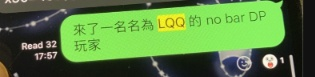
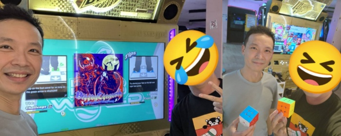

　　前陣子在 ptt 收到了封站內信，開頭是這樣的：

> 你好！ 我是鄭咩！ 玩魔術方塊的鄭咩
> 
> 很久不見... 非常之久 XD　　　　　　　（下略）
> 

　　寄信的人是很久很久以前一起玩魔術方塊的朋友，表示他現在人剛好在台灣，想趁「2026 台灣魔術方塊二十週年公開賽」時找些以前一起玩方塊的老朋友聚聚，並從版上寄信給其他老朋友。

　　其實，用「很久很久以前一起玩魔術方塊的朋友」介紹鄭咩好像有點太失禮了。如果以台灣魔術方塊界來說，他或許也能算上一筆台灣魔方界的梅原大吾[^1]。199X 年時台灣流行過一次魔術方塊，但就跟葡式蛋撻[^2]一樣，熱潮沒多久就退燒了。然而，2000 年後網路漸漸普及，有一群愛好者將魔術方塊開始在台灣慢慢推廣，鄭咩就是其中一人，也是當時台灣最厲害的幾個玩家之一。當大家解一顆魔術方塊還需要花一分鐘以上時，他只需要 20 秒，因此也常被找去綜藝節目[^1.5]表演魔術方塊。

　　回到當天下午，看到這封站內信後差點沒笑出來，因為不久前我才正想寄信給他。加了聯繫方式後，決定開頭就告訴他這件事情：

　　「Hi 鄭咩 我是 ＯＯＯ XD」

　　「居然！！！嗚嗚嗚，看到老朋友的 ID 就已經感動了，你有看到我的發文嗎？ 幾個小時前發的」

　　「其實我有一個驚天大秘密」

　　「幹 是什麼 好緊張」

　　「前陣子我原本也想寄信給你 哈哈哈」

　　「居然!! 為何？」

　　「我們已經有遇過，只是不知道對方是誰 XDDDD」

　　「真假」

　　真的。幾個月前不知道哪根筋不對，決定和朋友一起去家裡附近的大型電玩間玩 DDR 跳舞機。一到現場，發現有另外一位不認識的玩家已經在台上玩，而且看起來還滿厲害。

　　「有不認識的玩家在玩」聽起來很稀鬆平常，但在自己熟悉的店出現「比自己厲害又不認識」的玩家，老實說還真不可能，而且這傢伙玩的還是 DP no bar[^3]！

　　同為 DP no bar 玩家，當輪到我上去玩時，對方果然來搭話了。說他最近剛從美國回來，也是很久以前的玩家，最近才又回鍋。腦中快速掃過上古時期的玩家資料庫，我大概猜到可能是其中某個玩家，雖然卡名和以前不太一樣，但如果最近才回鍋，跟我一樣隨便亂改卡名，也是常有的事。

　　事情就這樣結束後，當時一起去電玩間的朋友某天突然丟了個連結來：



　

　　「No bar DDR DP 18？很強欸」

　　結果朋友回了句：「啊你不是跟他講過話？」

　　「有嗎？」當心裡這樣想著，才想到前陣子去跳 DDR 的事，然後隨著 youtube 頻道越來越往下拉，越看越不對勁……。

　　「欸，這頻道……我應該很久以前就認識他」

　　這下換朋友傻眼了：「你知道為什麼我會貼這頻道給你，因為他的興趣跟你高度重疊」

　　「那你知道他是誰嗎」

　　「誰」

　　「他是 ptt 魔術方塊版（前）版主」

　　「……」

　　沒錯，就是這麼扯，幾百年前一起玩魔術方塊的「塊友」[^4]居然在 DDR 機台相遇，而且重點那天講話時因為圈子差太遠，所以完全沒有認出來。然而，就在我打算找機會寄站內信和他說的時候，反而收到了他的站內信，恐怕連ＯＯＯ都不敢輕易採用這種誇張的設定.jpg。

　　回到一開始與鄭咩的訊息對話：

　　「你是不是有一天跑某大型電玩間跳 DDR」

　　「等等真的假的啦 XD，你是誰，我們有說過話嗎」

　　「有，因為我也是跳 DDR，跳一跳就有人來搭訕，說什麼從國外回來剛好來跳DDR，然後我有跟朋友分享有玩家跑來跳 DDR DP 跳得很不錯，但我可能認錯人，以為是某個很久以前的其他人……」

　　「過了一兩個禮拜，他就貼了你的 YT 連結，說是不是這個，我一看，這不是鄭咩嗎，哈哈哈哈哈」

　　「太誇張，我現在整個無法接受  XDD」

　　連當事人都無法接受，知道「恐怕連ＯＯＯ都不敢輕易採用這種誇張的設定.jpg」的厲害了吧。最後，我告訴他我在 DDR 遊戲內使用的 ID，他一查其他群組，發現今年二月就看過我了：

　　隨後在 Line 又聊了一陣，鄭咩：「要不要現在去（跳 DDR）？你有空嗎，哈哈哈」

　　距離下班不到半小時，而整件事情好笑到這程度，說什麼當然要去，一下班我就衝去電玩間，完成了這次的「塊友見面會」：

（事後問了鄭咩在 Blog 上方不方便露臉，不愧上過電視的半公眾人物，立刻大方答應，於是就能~~俗辣地~~光明正大地只碼自己）

　　雖然我們都是 DP 玩家，但不免俗還是一起玩了 SP，只差沒有邊跳 DDR 邊解魔術方塊（？），我們也聊了一下近況，結果才發現鄭咩居然有去本月的 TMA 魔術大會！這已經不是興趣高度重疊的問題了，因為鄭咩以前也認識許多雜耍專業人士，因此去了 TMA 魔術大會，雜耍魔術不愧本一家，非常誇張。

　　所以事出突然，雖然可能有颱風來攪局，但如果順利的話，我會去這周末的 [20 周年魔術方塊公開賽](https://cubing-tw.net/event/2026Taiwan20thAnniversary)（但沒有要參加比賽）見見老朋友，地點在台北捷運北投會館的地下一樓綜合會議廳，如果對魔術方塊有興趣的朋友，歡迎當天來湊個熱鬧，感受一下比賽的氣氛或單純找我聊天也行。

　　說真的，每次踏出門都沒人相信的Ｉ人如我，也感受到「有勇氣的人先享受世界」這句話的真實性。

　　我想，這就是人與人連結的樂趣所在了吧。

[^1]:〈[SF6 MenaRD vs 梅原大吾 FT10](https://lq7.tw/mood/sf6-menard-vs-daigo-ft10/)〉By LQ7。

[^1.5]: [鄭惟駿@綜藝大哥大 魔術方塊表演](https://www.youtube.com/watch?v=fEnAnZuYe0U)

[^2]: 認為「葡式蛋撻現在還是很多人在吃」的朋友，可能無法想像當時要買一盒六顆的葡式蛋撻要排隊排多久，大概就跟福義軒蛋捲一樣（結果現在福義軒蛋捲也到處都買得到了，完全沒解釋到🤔）

[^3]: 「DDR DP no bar」 ：使用全部 8 個踏板之下，過程中完全不靠雙手扶後方欄桿來支撐平衡的遊玩方式，現代玩家已幾乎沒人練習此種玩法，都是扶 bar 在玩。

[^4]: 還沒搞定「格友」的全域註腳，