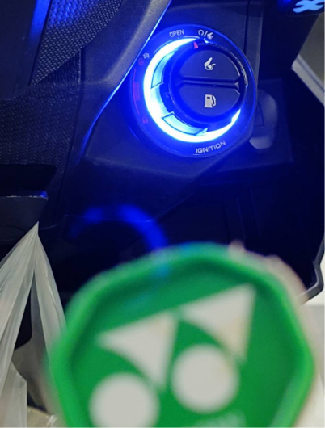

　　星期四晚上又來打羽球！

　　這篇原本的標題該是「為什麼我沒在用 RSS」，但為了不重蹈 yangbear「[在標題說反話](https://yangbear.bearblog.dev/n1-goukaku-suru-niwa/#:~:text=%E6%A0%B9%E6%9C%AC%E5%B0%B1%E5%9C%A8%E6%A8%99%E9%A1%8C%E8%AA%AA%E5%8F%8D%E8%A9%B1)」的覆轍，就乾脆想說星期四打羽球時再來寫，加上本周許多想寫的雜談，湊成準備在羽球場邊胡思亂想的文章。Here we go！

### Blog 翻修

　　在百翁[^1]新刊完成後的這段空檔，決定翻修一下 Blog。

　　但與其說是翻修，也只是精簡了一直以來想精簡的分頁，然後將「首頁」和「關於我」的文字更新，最後將「LQ7 的創作與想像」標題換成了「LQ7 的思考與閒聊」。

　　雖然「創作與想像」這說法很美，但總覺得自己日漸搞耍的文字（？）已漸漸搭不上如此給掰的標題，最後決定換成更平易近人的「思考與閒聊」。然而在更換標題前，我也猶豫了一陣到底該用「思考與閒聊」還是「閒聊與思考」，後來覺得結尾二聲比較順口，沒多久就將「閒聊」與「思考」換了位置，變成了「思考與閒聊」。

　　或許，就是文學的醍醐味了。

### 文學的醍醐味

　　扯到文學的醍醐味，就不得不提碩人的〈[文字雜想](https://shuojen.com/blog/2026/10/13/period)〉。郭松棻老師的「一個標點符號放對了位置，就會令人不寒而慄」的說法，正是任何文章寫作的第一課，而最初我聽過的版本是這樣的：

> 「一篇文章的精隨，就是將正確的標點符號放在正確的位置上。」
> 

　　這件事聽起來很簡單，很多人會立刻想到現在 AI 都能辦到，但何謂「正確」，卻是所有作家一生所追尋的答案，在我眼裡，AI 的「正確」一點都不「正確」，但容我有空再細說[^2]。

　　同樣的概念，也不時就出現在各種寫作要領的書籍裡：

> 「沒有什麼能比一個放在恰當位子上的句號更能打動你的心。」 By Isaac Babel
> 

> Connell 在談論小說修改時說，當他開始刪除一些逗號，隨後又把這些逗號放回原處時，他知道這部小說差不多寫完了。
> 

　　雖然大概又在貼金，但我的寫作經驗和 Connell 完全一致。當第 N+1 校的時候發現開始把第 N 校的東西改回來，那就代表整本書快完成了。但如果提到寫作經驗，大概三天三夜說不完，我想也有空再細說（again）[^2]。

### 「後記」

　　既然提到了文學的醍醐味，大概也不得不提最近 Ikuka 大大剛好也聊到的「[後記](https://blog.ikukaroom.com/oct-01/)」，先前她認真思考了到底該不該用「後記」這詞，也在[最新文章](https://blog.ikukaroom.com/oct-02/)的最後，改用了「文末」這詞。

　　我一直認為，「後記」是我個人無論寫 Blog 和同人小說的獨特文學語感。事實上，一篇文章（尤其是 Blog）不用打「前言（序）」，「本文」，「後記」也有幾百種方法能讓文章好好呈現，但從好久以前，我就覺得在無論輕鬆還認真的網路文章中打出制式工整的三段式標題很有趣，所以不時就把它用來做為文章節奏的一部分。

　　這讓我想到《[五星主廚快餐車](https://www.netflix.com/tw/title/70297087)》裡的一幕。當主角做好三明治端給兒子時，兒子這樣說：

　　「媽媽會把吐司邊切掉。」

　　主角：「嗯，我不切。」

　　吐司邊切不切並沒有正確答案，但構成了烤三明治的詮釋。就算兒子那句話有「比較想吃有切邊的三明治」的情感在，也不影響主角切不切邊的決定，因為主角早就「想過了」。

　　不只是 Blog，就算是同人小說也一樣。我任性地覺得我的同人小說就該有「序」、「後記」、「鳴謝」，第一本書印刷時原本還想大費周章找遠在美國的朋友幫忙寫「推薦序」，最後沒成真是抱歉。

　　但大概就跟《[五星主廚快餐車](https://www.netflix.com/tw/title/70297087)》道理相同：

　　「別的同人本都不用『後記』這詞。」

　　LQ7：「嗯，我的會用。」

　　吐司切不切邊，同樣不是主角發明的做法，不如說這世界上三明治多半只有這兩種處理吐司邊的方式。但當他認真考慮過這件事後，這「不切邊」的做法，自然就會形成他獨一無二的三明治詮釋。

　　在此恭喜 Ikuka 大大找到了屬於她的文字美感與詮釋。

### 為什麼我沒在用 RSS

　　終於前後呼應（？）回到標題了！

　　但如同開頭所述，其實我還是有在用。我會打開 Feedly 看些可能一兩個月才發一篇文章的朋友有沒有更新（畢竟沒記住網址），但現在大部分時我更習慣直接在瀏覽器打網址，去看其他格友的文章。

　　原因有兩個。一是如果用 RSS 看文，排版就不是「原作的詮釋」了。先不論 RSS 不吃部分 html 語法的問題，光是我的寫作習慣「開頭空兩格」一到 Feedly 就只剩下一格，感情上實在不能接受，更枉論有些精美排版的文章，如果用 RSS 閱讀反而更像是在破壞作者精心設計的文字閱讀美感。

　　「但 Feedly 也可以設定點文章就直接跳進網站閱讀呀！」

　　沒錯，所以第二個理由來了，發現「有人發了文章就有通知」和 ptt2 的紅色勾勾一樣，久了產生「要把所有紅勾勾都消掉」，這樣的制約我也不太喜歡。所以如果只是把 RSS 當作書籤，那直接把許多格友的部落卷當書籤也差不了多少。就算不是自己的部落卷，除了能順便發現新 Blog 外，那些常看的 Blog 我也一看就知道是哪幾個，意思也完全一樣。

　　這次翻修 Blog 時我調整了字元的大小和間距，讓版面符合我想要的閱讀節奏時，有考慮過是否把 RSS 改回大綱，強迫（？）大家點進網頁閱讀，但後來想想讀者的習慣也不等於自己的習慣，就還是維持原樣就好。

　　但本 Blog 終究推薦大家直接在網站閱讀，以獲得最佳閱讀體驗。

### 機車電瓶

　　看到碩人的〈[檔車推發記](https://shuojen.com/blog/2026/10/14/push_start)〉（怎麼又是碩人），雖然這大宇宙電波有點 Delay，但還是不得不分享一個月前發生的事。

　　目前我騎的機車，有著最新最潮的 Keyless 裝置，也就是只要鑰匙在附近，就可以轉動圓盤開關啟動機車。老實說是真的方便，這樣一來就再也沒有忘記拔車鑰匙的問題。當然，有一好沒兩好，雖然機車熄火時轉動圓盤就會斷電，但中間還有一個檔位是機車沒發動，卻能開車廂和油門蓋的檔位。因此如果把檔位卡在這裡，機車就會一直耗電，和汽車大燈沒關有異曲同工之妙。

　　一個月前的某天，我準備去牽車時發現圓盤居然還是亮的。按了按開關發現儀表板有亮，但發不動。於是我把車從地下室推上一樓，慶幸著不就好險平常有運動習慣這點重量……還是有夠重的同時，終於推到家裡附近的機車行。

　　老闆：「這你放多久了，電瓶可能充不進去要換了喔！」

　　「先幫我充看看好了？」（心中ＯＳ：電瓶不就是充電放電哪有充不進去的道理，汽車電瓶沒電不是夾兩個夾子就能充？）

　　在機車行充了半小時後，果然充好了，我就說吧，差點被老闆薛惹。

　　……結果過沒幾天，我又忘了關開關！

　　這次可沒那麼幸運了，儀錶板亮都不亮，只剩下開關的燈亮著。再度把車從地下室推上一樓，慶幸著不就好險前幾天有練過同樣的動作……搞啥啊！一到機車行老闆一臉「怎麼又來了」的表情，然而，這次這次可沒那麼幸運（again），充了半小時，絲毫不動，老闆說這鐵定是壞了。

　　一邊換新電瓶的同時一邊和老闆聊這 Keyless 設計真是做一半，不像很多汽車現在都有自動斷電，一忘記關就是一千多元，這學費繳得真不便宜。搞定後回家立刻做了功課，才發現老闆一開始就沒有騙我，鉛酸電池就是這麼嬌貴：
 
> 「之前有說過，鉛酸電池放到沒電會怎麼樣？當電壓跌到極低且維持一段時間，內部的硫酸鉛會結晶硬化，徹底破壞化學結構，這時候就算接電也吃不進去。當搞成這樣時，你的鉛酸電池就是去見上帝了，只能換一顆。」
>
>　
> 
> 「聽到這邊一定有同學在想：『ＬＱ７，哪有這麼嚴重？我汽車電瓶也很常放到沒電，每次只要和其他車借個電就復活了。』有這種想法的同學，ＬＱ７會幫你向上帝祈禱，請上帝保佑你的電瓶不要沒電，就算真的沒電，也能順利回充。」
> 

　　以上改編自〈[王醫師會幫你向上帝祈禱](https://togetoge.cc/wang-yi-shi-hui-bang-ni-xiang-shang-di-qi-dao/)〉。王醫師雖然看似講話劍劍的，但人其實非常好，先前的〈[東南亞追星旅遊](https://togetoge.cc/tags/lu-you-ji-xing/)〉也寫得超好笑，推薦觀賞。

### 後記

　　其實原本這次不打算寫後記，但為了「中」後呼應還是搞了個後記。原本想在星期四打羽球把所有雜談包括百翁[^1]的[格友見面會](https://shuojen.com/blog/2026/10/09/meetup)（才發現這整篇文章到處都連到碩人那）通通一次講完，但無奈與球打到現在只剩最後半小時，看來百翁流水帳就只能等到之後再說了。

　　星期四打羽球，在這個大概又要吃麻辣臭豆腐（但今天有點想吃麥當勞的節奏下）我們下週再見！

　　（編按：最後還是吃了麻辣臭豆腐）

[^1]: 百合 Only，圈內人習慣簡稱「百翁」。

[^2]: 「有空再細說」的文章不知道有沒有欠了超過十篇，真是抱歉，或許之後相關文章該有個「有空再細說」的 TAG。