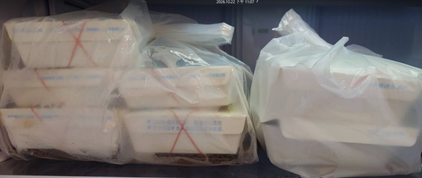

　　颱風宣布停班停課的當下，星期四晚上依舊要打羽球！

　　這週末原本打算明天就北上的行程，包括什麼魔術方塊大會和「一個讀書會」的團健活動，看來因為這個目前停在東岸打轉的颱風，都不克前往了。我想，這也是普通和理所當然的一環吧。

　　每次回台北，我也是個很喜歡騎 ubike 的人。記得很早以前提過我[喜歡人力移動勝於搭車](https://lq7.tw/mood/seven-fun-facts-about-lq7/#4-%E5%96%9C%E6%AD%A1%E9%9D%A0%E4%BA%BA%E5%8A%9B%E7%A7%BB%E5%8B%95%E5%8B%9D%E6%96%BC%E6%90%AD%E8%BB%8A)，台北有著全台灣最健全的 ubike 網路，要從我家橫跨整個台北市跑去淡水我想都行。當然，我最喜歡夜晚騎車，這時段也是車潮比較不擁擠的時段，這樣才能放心騎在大馬路上。

　　在我爸住院的時候，因為我妹說了「可以體驗看看電輔車」，向來把騎單車當運動的我首次租借了尊爵不凡起價就需 20 元的電輔車。呃，總覺得這件事情好像在哪講過（還是曼德拉效應？），總之最後還車時發現只耗了 1% 的電，先不說少運動到這 1% 超級吃虧，電輔車起跳價還要多收我 20 台票，簡直賠了夫人又折兵！

　　所以回去通盤檢討一番，下次學乖了，既然都要多花 20，不要還在那邊想要運動，要轉換心態，要當作像在搭計程車一樣去蕭貪。根據研究，電輔車一到時速 25 公里以上法律規定就不能幫忙出力，而 ubike 的設定似乎又更保守，看起來只要超過時速 20 公里就不幫踩了。而且根據上次的經驗，也不是 20 公里以下就鐵定幫踩，而是當機器感覺你「沒力」速度開始往下掉之後，才會加速。

　　很好，區區 ubike 電輔車已完全被我破解，該來實際實驗看看了。首先，再借台電輔車，踩個幾下讓車子維持在時速 20 公里，然後假裝踩不動，讓速度掉下去…….有欸！車子開始幫忙加速了！一直重複這個循環，一趟騎下來相較於上次只耗 1% 電力，這次居然耗了5%！賺翻！！！

　　……以後還是租普通的 ubike 就好了，從台北市騎到新北市還免費 🫪🫴

　　再來想分享的，是今天下午在「[一個讀書會](https://club.1-know.org/)」發現的好笑資訊，因為實在太好笑了，就想說一定要在打羽球的時候把它~~偷~~貼過來。這個知識是這樣的：

> 印歐語系中，-a 作為前綴有否定的意思，英文的例子我們很熟悉比如：
> 
> - asymmetric 不對稱的
> - atheist 無神論者
> 
> 有趣的是，同為印歐語系的梵文也有這樣的例子，而且我們其實常常看到：
> 
> - 阿彌陀佛：a + mita(測量) = 不可測量的
> - 阿修羅：a + sura(天神) = 非善神 = 魔神

　　LQ7：「突然想像把別人正在念的「阿彌陀佛」替換成「不可測量」 有種滑稽感 🥹」（🤣x1）

　　右衣：「想像把不可測量替換成阿彌陀佛」（🤣x3）

　　LQ7：「薛丁格的量子力學方程式實在是阿彌陀佛……」（🤣x1）

　　右衣：「你的理論阿彌陀佛」

　　嗯，就是這樣。

　　剛剛在球場邊又想到，先前紅極一時（？）的阿彌陀佛姊[^1]，頓時變得有些學術，像是什麼量子力學的研究者一樣……

　　看來本篇文章至此也阿彌陀佛。

　　今天的羽球閒聊就到此結束了，雖然看起來有點短，但原本想繼續聊點上篇推薦的《地。-關於地球的運動-》漫畫，或者開始鋪陳一直欠著的「百合 only 參展流水帳暨格友見面會」，似乎時間都有點尷尬，不如先想想等等要吃什麼好了。

　　不對，今天除了「等等要吃什麼」還得順便想一下「明天要吃什麼」，因為明天颱風假，最嚴重的就是附近店家多半不會開之外，所有外送平台也會關閉，這真是自宅警備員的最大危機！此時就是要先點好兩天的存糧，或許連星期六也要點，這樣才夠安心。（於是有了本篇的照片）

　　星期四打羽球，我們下週再見 👋

[^1]: [https://zh.wikipedia.org/zh-tw/高美玲](https://zh.wikipedia.org/zh-tw/%E9%AB%98%E7%BE%8E%E7%8E%B2)