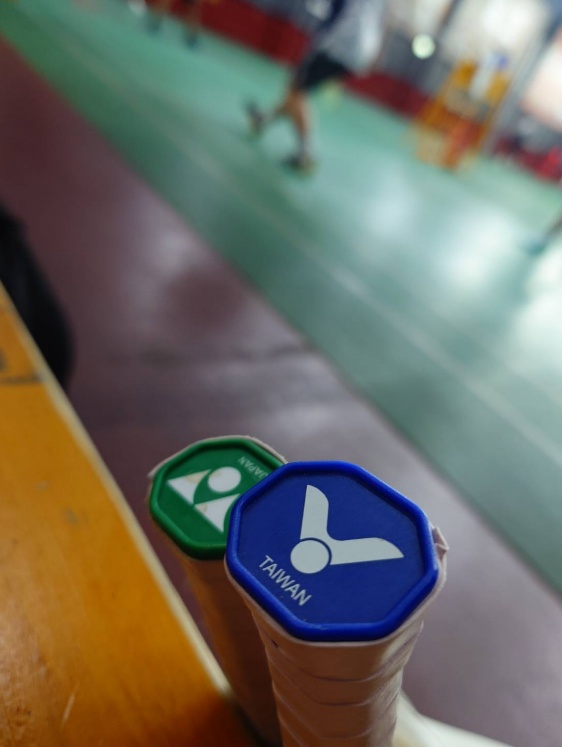
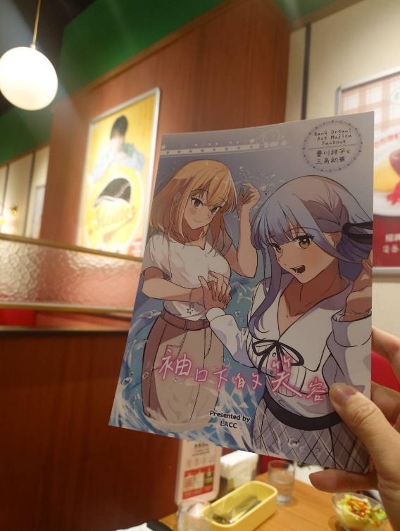
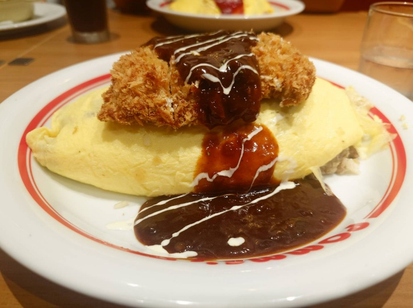

　　星期四晚上打羽球，才剛到場邊就在想晚上要吃甚麼了。

　　每次打完球都會陷入一個「麥當勞循環」，也就是說十點過後順路且還開著的店家也就那幾間，雖然麥當勞是個非常不錯的選擇，但總有「打完球就爆吃一頓麥當勞」整晚運動量就前功盡棄的想法。因此看了一下過往紀錄，似乎很久沒吃麥當勞了，但我有預感今天麥當勞指數會贏，因為實在太久沒吃了，總覺得最近許多事情終於都告一段落，今天或許就是那命中注定得吃麥當勞的時機。

　　說到晚餐，昨天和邦友[^1]聚餐，由於其中一位要從善化來，因此地點選在了三井 Outlet。不如讓各位猜猜我們吃了哪間店？

　　沒錯，又是傳說中的 [ikuka 蛋包飯](https://travlog.wei-lee.me/posts/travel/2026/07/pomunoki-tainan/)！

　　這是我第三次造訪這間店，而最離譜的是三次坐的位置完全一樣，通通都在有岡大貴桌的旁邊，簡直不要太離譜。

　　（與另外兩位邦友波波和 LACC 交流，圖為 LACC 老師畫的初祥一般向同人本）

　　這次我選擇的是豬排蛋包飯，裡面的飯則非常搞怪地選擇了「絞肉」，而不是奶油或番茄，吃起來其實非常不錯，但總覺得這樣弄還能算「蛋包飯」嗎，總會有這個疑惑在內心響起。

　　但又不是 Carbonara[^2]，基本上我對蛋包飯的寬容度非常高，或許白飯上面蓋個荷包蛋後和我說是蛋包飯，或許也能接受（冷靜想想應該不行）。

　　題外話，這間店現在的熱潮已過，平日幾乎沒半個人，假日非尖峰時間也不用排隊就能進，而且不查還好，一查發現這間蛋包飯的 google 評價非常之低，畢竟這間店實在不便宜且並未對「台灣口味」做大幅調整，因此整體偏鹹，所以有這結果，我想也不太意外。

　　看來照這造訪的次數，總覺得有機會將裡面的所有口味都吃過一輪，只要保佑在這之前不會因為人潮太少而倒掉就好。ikuka 蛋包飯，加油Ｒ。

　　最近三篇文章不離 ikuka，也實在非我所願。有時候宇宙大電波就是這樣，像今天在思考「人與人之間的信任」這件事情時，就看到[格友 Alice 推薦了《為信任立界線》](https://alicehsu.blog/zh-tw/posts/2026/10/trust-by-dr.-cloud/)這本書，提到了「信任是整個生命的燃料」這件事，我非常同意。人類這生物能迅速地相互合作，其實就是歸功於我們能對「毫無保證」的事情信任的緣故。如果沒有這層信任，那老實說，這世界上「所有事」大概都不用做了。

　　對，沒錯，這邊說的是「所有事」。舉例而言，或許寫 Blog 的朋友有一部分的人是因為不信任馬斯克或祖克伯的社群軟體，但就算買了網域，難道頂級域名就沒有消失風險嗎？稍微一查就知道頂級域名同樣是有機會消失的，也就是說地址雖然是你買的，但抱歉這地區不存在了，請你搬家吧[^2.5]。不信任雲端空間所以將資料儲存在自家 NAS，難道 NAS 的硬碟就不會壞？「嗯，但是我有做 RAID 啊！」，就算是這樣，那也只是你「信任」這幾顆硬碟不會同時壞而已[^3]。退一萬步，擺放 NAS 的地方難道就能完全信任？難道插座的電線是自己親手拉的？機房真不會淹水？

　　這樣一講下去的確沒完沒了，因為就算房子是自己買的，水電真鐵了心要跟你亂牽線，驗屋時也很難第一時間發現。以前有個新聞，有人不信任銀行所以將所有現金鈔票存款放在自家床底下，最後被白蟻吃了大半。就連這種人，也是「信任」將現金放在床底下一定沒任何問題，但仔細想想同樣也「毫無保證」的事。

　　因為這世界分工太細了，所以人總歸必須相當程度地「信任」他人，才有辦法能人類社會中生活下去。

　　我認為，我算是相當程度信任這世界上的多數事情，和我爸我媽不同。例如我媽以前會偷翻我皮夾內的發票，調查我去哪裡鬼混，我爸也因為不信任電子發票，所以用了沒多久還是繼續拿紙本發票，但這部分我想留到「我媽」之類的文章再一併細說。

　　反觀我想到非本班卻非常信任學生的傳奇高中老師，在學生翹課教官來抓人的時候，幫學生辯護「他們只是都聽懂了所以去圖書館自習」，結果被教官抓到翹課是去打網咖的時候，還能繼續說「學生翹課去的網咖，是因為他們現在需要打個網咖」、「這些孩子都很優秀，知道他們自己在做什麼」。

　　「學生現在需要打個網咖」從一個老師口中說出來，到底有多離譜不說，我想老師本人不管再怎麼相信學生，多少還是會有點心虛吧。但高中老師能信任自己的學生到如此程度，我認為還是非常了不起。如果是我的高中老師，應該就無法那麼信任我，畢竟如果是我翹課打網咖，那鐵定就是單純不想讀書，並沒有什麼冠冕堂皇的理由。

　　今天的胡思亂想沒什麼重點，大概也是今天沒有先在來打球之前想好到底想要想什麼。但這也是一直有點在意的部分，如果想好再打，看來就不是「胡思亂想」，反而是「精心策劃」的亂想了。

　　「精心策劃」最近好像很紅，但我想 Blog 的胡思亂想，帶有一點「精心策劃」或許也沒關係。

　　究竟今天會不會去吃麥當勞，還是又回到老梗的麻辣臭豆腐呢，就像我們拭目以待。

　　星期四打羽球，我們下週再見。

### 後記

　　吃了麻辣臭豆腐！麥當勞居然輸了！Amazing！

[^1]: 忘了有沒有解釋過因此再解釋一次，因同樣喜愛 BangDream 少女樂團企劃（邦邦）認識的朋友簡稱「邦友」，和「格友」、「塊友」類似。

[^2]: 正宗 Carbonara 只能放這四樣東西，Guanciale（風乾豬頰肉），起司，黑胡椒，蛋，但凡多加了其他的東西就不能叫 Carbonara。

[^2.5]: ~~.tw 消失的風險搞不好比 Facebook 還高🫠~~

[^3]: FAE 處理 RAID 1 兩顆硬碟短時間內同時壞掉的事我想並不是那麼少見。