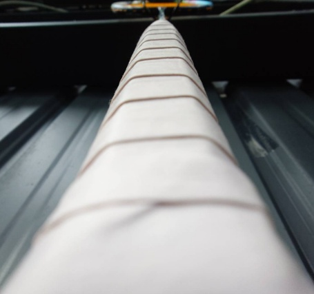
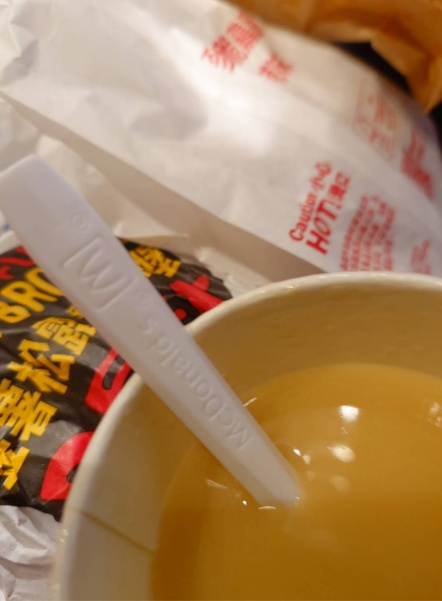

　　星期四晚上沒有跟[帥熊一起打羽球](https://yangbear.bearblog.dev/kumabadominton/)[^0.5]。

　　雖然希望哪天真能和帥熊打羽球，但羽球網子高度對帥熊而言，可能有些太高。先前和朋友的小孩單打，無論是體力還是腳步都非常有模有樣，可惜國小生的身高，殺球的球質再怎樣都不太可能比大人來得犀利，因此才有辦法靠著「大人的力量」應付。

　　但說來羽球已經是不太吃身高的運動了。剛上大學時，同時也打過一陣子排球，但以我的身高要當個立派な攻擊手，基本不太可能。系上一個從小打排球非常厲害的學長雖然在系隊能當攻擊手，但也因為身高因素，在校隊就只能打自由球員的位置。

　　先前在其他時間偶爾會和我打羽球的朋友，因爲膝蓋的關係目前暫停打羽球，他說或許改天可以一起打網球，附近剛好有免費的球場可以使用。印象中我一直以為網球是比羽球還要稍微貴族一點的運動（以場地花費而言），但沒想到現在的戶外球場居然還有免費的，而且不像羽球一樣非得在室內球才不會亂飄，真是不錯。

　　但就跟帥熊類似，這輩子不管星期幾我也都從來沒打過網球。當然部分原因也是因為網球和羽球的施力方式剛好完全相反，以前為了不讓自己混淆，所以除了愛看電視比賽轉播外，實務上一直和網球保持著距離。

　　時日今日仔細想想，又不是要打比賽或當國手，跟朋友打打網球初體驗看看也不錯。

　　接著我想補充一下上篇[研究所考試](/mood/grad-school-exam/)的後續，因為碩人的〈[中央大學趣事](https://shuojen.com/blog/2026/11/03/ncu)〉讓我想到考完研所後發生過同樣的往事。而這段各種意義而言才是那篇文章真正所謂的「後記」，和自己平時搞耍的後記不太一樣（？）。

　　首先為什麼我研究所需要用考的，那當然是因為大學都在混的關係[^1]，四年的課程我理所當然（？）念到了第五年，而且在第五年時還有一堆必修，包括傳說中「五修」的線性代數。而這也不是因為線性代數真有這麼難，想當然爾是都沒去上課導致。因此，「考研所不用準備」某種層面也是個謊言，因為平時去上必修課就是最好的準備了，那些別人快畢業時就都快忘光的必修課程，我可是在畢業吋前都還耳熟能詳，嘿嘿。

　　所以就在確定考上研所後，真正的考驗才開始，但凡有一科必修沒過而無法畢業的話，除了研所白考，我看又是另一條必須要念大六的平行世界線了。但這年大五或許就如同之後的碩士論文，因為知道再搞耍真會出大事因此非常認真，資工系四年的精華我可能一年就這樣學完了（也證明大學只看必修其實兩年就能唸完）。

　　但就算如此，其中還是有讓我擔心的科目，那就是「作業系統（二）」這門學科。老師很認真，我也很認真，但期末考真是非常得難，難到考完後我甚至懷疑沒有一題是對的。由於期末考占總成績占比非常高，成積也會和最後的學期總成績一起出來，我就每天抱著忐忑的心情刷新成績網站，某天甚至覺得這科被當的機率實在太高，是否乾脆跑去找老師直接問成績，萬一沒過是不是有補考的機會之類（但老師沒有回信）。

　　結果就在某天，總成績刷新了，我拿到 93 分。

> [「我們在想像中受的苦多於現實中」](https://lq7.tw/thinking/we-suffer-more-often-in-imagination-than-in-reality/)
> 
> ──塞內卡（Seneca）
> 

　　沒錯，如果早點看過未來自己寫的文章就好了呢 😩！

　　星期四依舊在打羽球，我們今天懷抱著一定要吃麥當勞的心情下次再見。

### 後記

[^0.5]: 當時看到文章列表的標題就笑了🫠

[^1]: 其實套在任何求學階段也通。