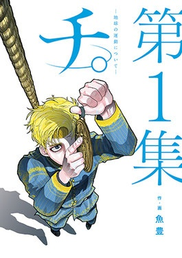
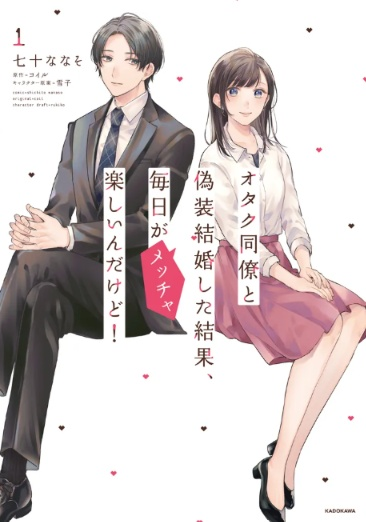
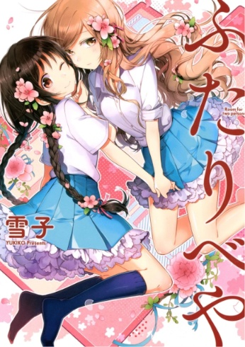
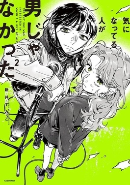
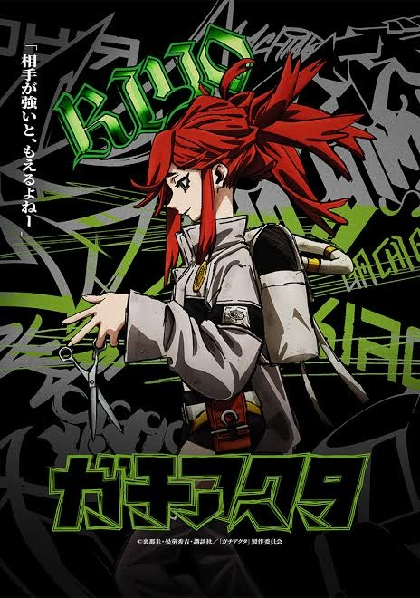

### 前言

　　最近看的五部漫畫。

### 《地。-關於地球的運動-》

　　《[一百公尺](https://zh.wikipedia.org/zh-tw/%E4%B8%80%E7%99%BE%E5%85%AC%E5%B0%BA%E3%80%82%E2%80%94100M%E2%80%94)》的作者魚豊老師，在本作用非常厲害的方式描述了「宗教」、「思想」、「信念」、「自由」等議題。明明這樣的主題一不小心就會陷入說教俗套，但書中所有角色卻奇蹟似地自然對話並引領著劇情流動，讓我想起了當初看完手塚老師《[火之鳥](https://zh.wikipedia.org/zh-tw/%E7%81%AB%E4%B9%8B%E9%B3%A5)》後整夜睡不著的心情。

　　一查作者魚豊老師大學曾就讀哲學系，對尼采康德略懂的他或許也說明了劇情為何會有如此深度。但我真正佩服的，還是劇本架構和引領角色的功力，回想起來明明暴力場面沒有少過，閱讀時卻能將重點放在感受並體驗每位角色的心境，實在非常非常非常厲害。我最喜歡的兩個劇情高潮橋段，就算睡了一覺，角色的聲音（明明是漫畫）卻像是在腦中揮之不去，已想不出上次看到如此超乎想像的漫畫作品是什麼時候了。

　　通常先看完漫畫的我，對動畫多半興致就沒那麼高昂，但現在我非常期待動畫的表現，打算將漫畫沒有注意到的事情在動畫重想一遍。當真正厲害的作品完成時，那音量在心中久久不能忘懷，我想這就是藝術創作的真正魅力了。

　　對「宗教」、「思想」、「信念」、「自由」等議題在漫畫上呈現有所期待的朋友，這部漫畫推薦給各位。以 LQ7 各藝術作品涉獵數量與範疇擔保，本作品絕對超乎各位想像。

　

### 《オタク同僚と偽装結婚した結果、毎日がメッチャ楽しいんだけど！》

　　這部台灣好像沒代理就放原文了，翻成中文大概是《和阿宅同事假結婚，結果每天卻非常開心》，看沒多久就因為「代入感太強」跑去和太太分享，結果太太說會這樣的原因是「男女主角同時是我」，雖然我完全不同意（裡面男角各方面不現實到完全不是個偶像宅該有的「正常」），但又總覺得好像也不能說錯。

　　所以，我就又跑去推薦給 [SYM](https://togetoge.cc/) 看了。結果他看完第一集後這樣說：

　　「看了第一集有點理解你老婆的意思」

　　「兩個人的思考邏輯都跟常人不太一樣，但又跟常人一樣有很多私心的感覺」

　　「還不錯，不是那種真的很超脫現實的空想劇」

　　好吧，事以至此，終於可以光明正大用這根本就是我.jpg（嚼薯片）。

　　此部推薦給喜歡 BG 日常戀愛番的朋友，近期內最喜歡的戀愛番。

　

### 《雙人部屋》

　　雪子老師的作品，日常輕鬆百合四格溫馨小品，很愉快地看兩位主角貼貼，喜歡日常系溫馨互動的朋友可以試試。

　

### 《**我在意的對象並不是男人**》

　　同樣溫馨短篇漫畫形式呈現兩位主角的貼貼，同樣喜歡日常系溫馨互動的朋友可以試試。

　

### 《GACHIAKUTA》

　　在場次上看到拿著一把超大剪刀的帥氣理遙，於是就跑來看這部漫畫。喜歡漫畫的筆觸和分鏡皆屬上乘之作，可惜劇情是少年漫畫的俗套，喜歡熱血少年漫畫的朋友可以看看，但個人似乎已過看這類漫畫的年紀（？）。

　

### 後記

　　這篇文章就是為了推薦《地。-關於地球的運動-》而生。超級不得了！快看！